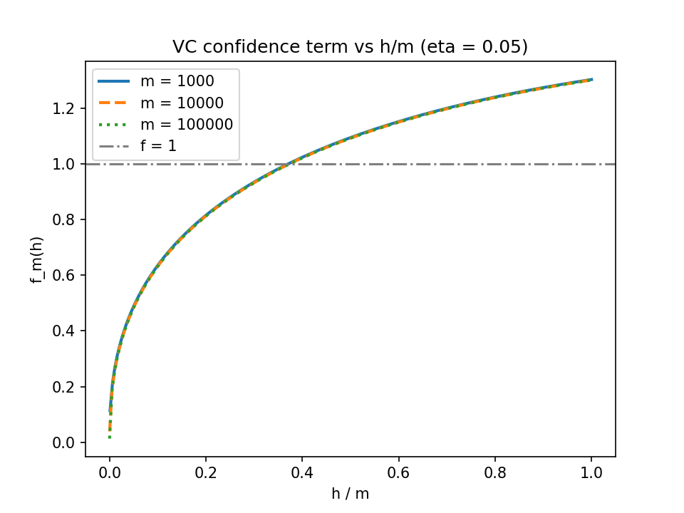
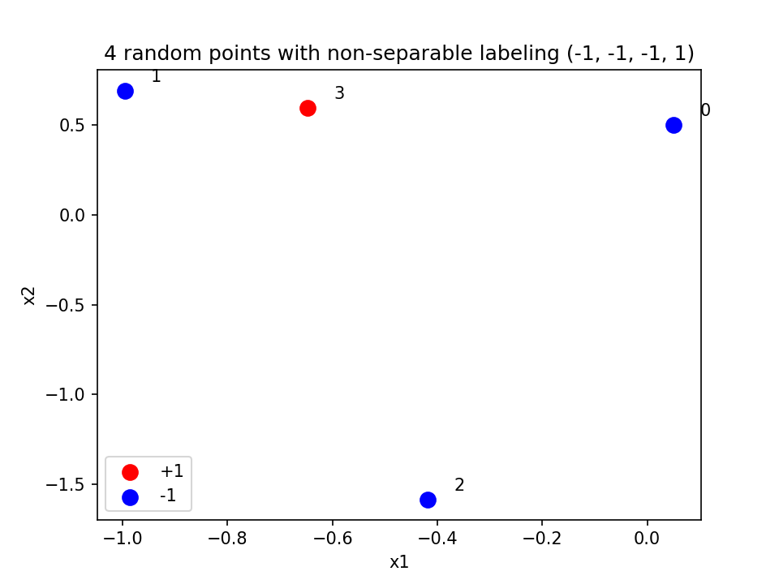
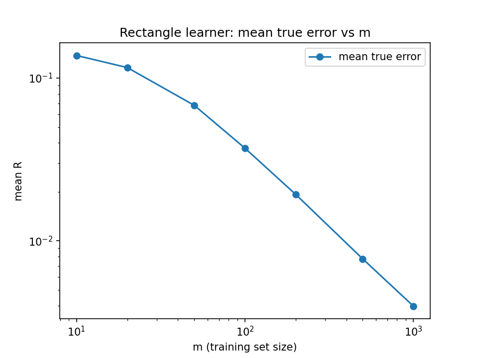
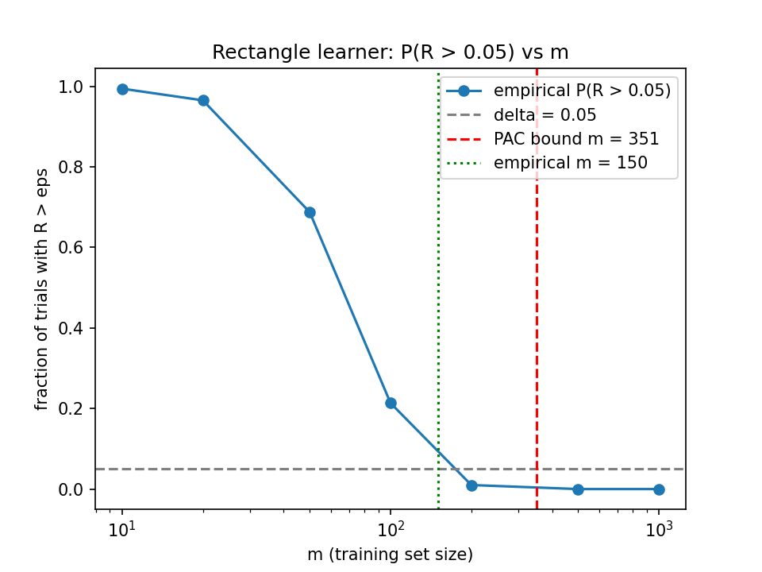
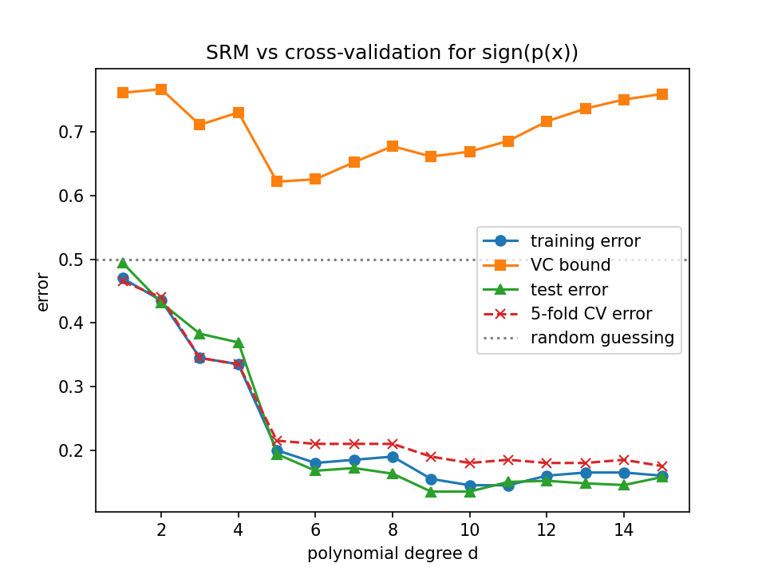

# Part I: Programming

## P1. The VC confidence term

**(a)** All three curves look almost the same when plotted against $h/m$. They go up fast at first and then flatten out, ending around 1.30 at $h/m = 1$.

{width=75%}

**(b)** I got $h/m = 0.3708$ ($m = 1000$), $0.3731$ ($m = 10^4$), and $0.3733$ ($m = 10^5$). These match the $\approx 0.37$ from the notes. With $r = h/m$,
$$f_m(h)^2 = r\left(\ln\frac{2}{r} + 1\right) - \frac{\ln(\eta/4)}{m}.$$
The first term only depends on $r$. The only part that depends on $m$ is $-\ln(\eta/4)/m = \ln(80)/m \approx 4.38/m$, which is tiny for big $m$. So the root is basically wherever $r(\ln(2/r)+1) = 1$, no matter what $m$ is. The small shift for $m = 1000$ comes from that $4.38/m$ term.

**(c)** With $m = 10^4$ and $R_{emp} = 0$, the largest $h$ is **11** (bound = 0.099). With $R_{emp} = 0.05$ the largest $h$ is only **2**. So even with 10,000 examples the bound can only promise 10% error for a really simple model (VC dim around 11), and if there's any training error the budget is almost all used up. The bound is very restrictive/pessimistic. In practice people get good test error with way more complex models and fewer examples.

## P2. A shattering checker

**(a)** $(0,0),(1,0),(0,1)$ are shattered. $(0,0),(1,0),(2,0)$ are not, since the labelings $(-1,+1,-1)$ and $(+1,-1,+1)$ can't be done (the middle point can't be on a different side from both ends). This doesn't contradict VC dim = 3 because VC dimension only needs *some* set of 3 points to be shattered, not every set. The non-collinear set works, so VC $\geq 3$.

**(b)**

| $n$ | $n+1$ points | $n+2$ points |
|:---:|:---:|:---:|
| 2 | 1.000 | 0.000 |
| 3 | 1.000 | 0.000 |
| 4 | 1.000 | 0.000 |
| 5 | 1.000 | 0.000 |

Random Gaussian points are in general position with probability 1, so every set of $n+1$ points gets shattered, and no set of $n+2$ points does. That matches VC dim = $n+1$ exactly: $n+1$ is the most points hyperplanes in $\mathbb{R}^n$ can shatter.

**(c)** My points (seed 4) were $(0.05, 0.50)$, $(-1.00, 0.69)$, $(-0.42, -1.58)$, $(-0.65, 0.60)$. The non-separable labelings were $(-1,-1,-1,+1)$ and $(+1,+1,+1,-1)$. Point 3 is inside the triangle made by the other three, so this is the "interior point" case. The predicted bad labelings are interior = $+$, others = $-$ and its negation, and those are exactly what the checker found.

{width=65%}

**(d)** The four points $(\pm1,0),(0,\pm1)$ are shattered by axis-aligned rectangles. 0 out of 1000 random 5-point sets were shattered, which fits with VC dim = 4. (For any 5 points, take the leftmost, rightmost, top, and bottom points as positive. Their bounding box has to contain the 5th point, so labeling that one negative can't be done.)

## P3. PAC learning in action

**(a)** $\hat h$ is the tightest box around the positive training points. All the positives are inside it, so they're labeled $+1$. Every negative training point is outside $c^*$. $\hat h \subseteq c^*$ because $c^*$ is a rectangle that contains all the positives, and $\hat h$ is the *smallest* such rectangle. So negatives fall outside $\hat h$ too, which means $R_{emp} = 0$. Since $\hat h \subseteq c^*$, the only mistakes are points in $c^*$ but not in $\hat h$ (labeled $+$ but predicted $-$). That region has probability $R = \text{area}(c^*) - \text{area}(\hat h) = 0.15 - \text{area}(\hat h)$ under the uniform distribution.

**(b)**

| $m$ | mean $R$ | $P(R > 0.05)$ |
|:---:|:---:|:---:|
| 10 | 0.1376 | 0.994 |
| 20 | 0.1160 | 0.965 |
| 50 | 0.0680 | 0.688 |
| 100 | 0.0371 | 0.214 |
| 200 | 0.0193 | 0.010 |
| 500 | 0.0078 | 0.000 |
| 1000 | 0.0040 | 0.000 |

{width=65%}

{width=65%}

**(c)** The bound gives $m \geq \frac{4}{0.05}\ln 80 \approx 350.6$, so **351**. Empirically $m = 150$ is already enough ($P(R > \varepsilon) = 0.0375 \leq 0.05$). So the bound is about **2.3x** pessimistic. That's honestly not that bad compared to the VC bound.

**(d)** The log-log slope is $-0.80$, so $R \sim m^{-0.8}$. That's closer to $1/m$ than to $1/\sqrt{m}$. For small $m$, the $R = 0.15$ cap (no positives found) flattens the curve, which pulls the slope down a bit. If you only fit the large $m$ points it gets closer to $-1$. Bound (2) gives $\varepsilon \sim (\ln|H| + \ln\frac{1}{\delta})/m$, which is the $1/m$ rate for a consistent learner. Bound (1) has a square root, so it gives $1/\sqrt{m}$ (well, $\sqrt{\ln m / m}$).

## P4. Structural Risk Minimization versus cross-validation

**(a)** A nonzero polynomial of degree $\leq d$ has at most $d$ real roots, so $\text{sign}(p(x))$ can switch sign at most $d$ times. If you sort $d+2$ points and alternate the labels $+,-,+,-,\dots$, you need $d+1$ sign changes, which is impossible. So no set of $d+2$ points can be shattered. For $d+1$ sorted points $x_1 < \dots < x_{d+1}$ and any labeling, put a root between $x_i$ and $x_{i+1}$ wherever the label changes (at most $d$ roots). Then multiply by $\pm1$ to get the first point's sign right. That's a polynomial of degree $\leq d$ that realizes the labeling. (If all labels are the same, use a constant.) So $VC(H_d) = d+1$.

**(b)**

| $d$ | train | VC bound | 5-fold CV | test |
|:---:|:---:|:---:|:---:|:---:|
| 1 | 0.470 | 0.761 | 0.465 | 0.494 |
| 2 | 0.435 | 0.767 | 0.440 | 0.431 |
| 3 | 0.345 | 0.711 | 0.345 | 0.383 |
| 4 | 0.335 | 0.731 | 0.335 | 0.369 |
| 5 | 0.200 | **0.622** | 0.215 | 0.194 |
| 6 | 0.180 | 0.626 | 0.210 | 0.168 |
| 7 | 0.185 | 0.652 | 0.210 | 0.172 |
| 8 | 0.190 | 0.677 | 0.210 | 0.163 |
| 9 | 0.155 | 0.661 | 0.190 | **0.135** |
| 10 | 0.145 | 0.669 | 0.180 | 0.135 |
| 11 | 0.145 | 0.686 | 0.185 | 0.150 |
| 12 | 0.160 | 0.716 | 0.180 | 0.152 |
| 13 | 0.165 | 0.736 | 0.180 | 0.148 |
| 14 | 0.165 | 0.751 | 0.185 | 0.145 |
| 15 | 0.160 | 0.760 | **0.175** | 0.158 |

**(c)**

{width=75%}

- SRM (min of the VC bound) picks **d = 5**
- 5-fold CV picks **d = 15** ($d = 10$ to $15$ are all within about 0.005 of each other, so it's basically a tie)
- best test error is at **d = 9** (0.135, $d = 10$ is tied)

SRM picks a smaller degree because the $f_m(d+1)$ penalty grows quickly with $d$ when $m = 200$, so it gets more conservative than it should be. The target $\sin(3\pi x)$ changes sign 6 times on $[-1,1]$, so you need around degree 6+ to fit it, and SRM stops right at the first big drop in training error. CV estimates the test error directly, so it goes higher. The CV curve is pretty flat from $d = 9$ on, so its pick is kind of noisy. CV and test error agree much better than the bound does.

**(d)** The bound is never informative. The smallest value is 0.62 (at $d = 5$), and every $d$ is above 0.5, which is worse than random guessing. So you can't use (1) to actually guarantee anything here with $m = 200$. It's only useful qualitatively: it shows the tradeoff between training error and capacity, and it gives a shape to minimize for picking a model. The actual numbers don't mean much.

**(e)** 1-NN gets **0** training error and **0.200** test error. 1-NN has infinite VC dimension (it can memorize any labeling), so the VC bound is useless or undefined for it. It still generalizes OK, though, because the true function is smooth in 1D and neighbors usually share labels. The error is about $2 \times 0.1$ noise rate, which matches the classic 1-NN result that it's at most about twice the Bayes error. VC theory is a worst-case bound over all distributions for the whole class. It doesn't say a high-capacity method *has* to do badly, just that it can't guarantee it does well.

## Bonus

**B1.** With $\delta = 0.02$, the threshold is $h > 1 + 32\ln 50 \approx 126.2$, so $h = 127$ just passes. Necessary $m \approx 126/(32 \times 0.01) \approx 394$. Sufficient $m$ from solving $f_m(127) = 0.01$ is about $1.72 \times 10^7$. That's a gap of around 44,000x. The upper bound has the $1/\sqrt{m}$ rate, so getting $\varepsilon = 0.01$ needs roughly $1/\varepsilon^2$ times as much, plus loose constants. The lower bound goes like $1/\varepsilon$. So the real answer is somewhere in a huge range.

**B2.** With the notebook classifier at $m = h$, $R_{emp} = 0$ every time, and the true risk is 0.50 (it's just guessing on new points). The bound $R_{emp} + f_m(m)$ is about 1.30-1.46, which is always above 1. So it's never violated (0 violations in all runs), but it's also completely vacuous. This is the example where training error tells you nothing, and the bound correctly says so.

| $m = h$ | $R_{emp}$ | $R$ | bound | violations |
|:---:|:---:|:---:|:---:|:---:|
| 10 | 0.000 | 0.501 | 1.460 | 0 |
| 50 | 0.000 | 0.499 | 1.334 | 0 |
| 100 | 0.000 | 0.500 | 1.318 | 0 |
| 500 | 0.000 | 0.499 | 1.305 | 0 |
| 1000 | 0.000 | 0.499 | 1.303 | 0 |

\newpage

# Part II: Essay

ESSAY GOES HERE
